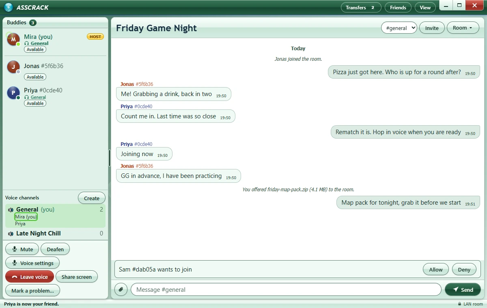
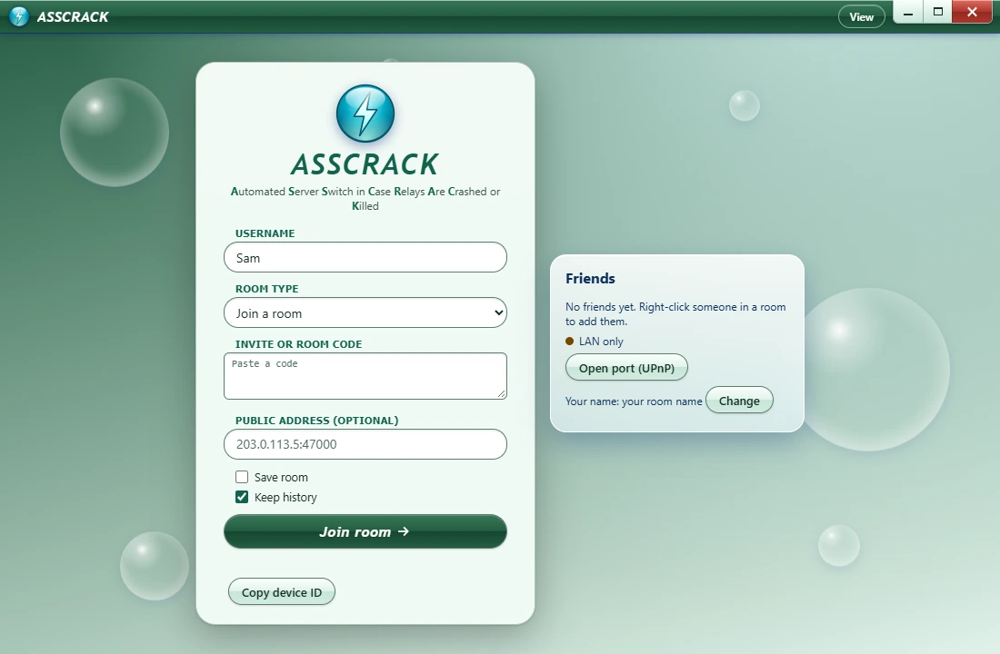
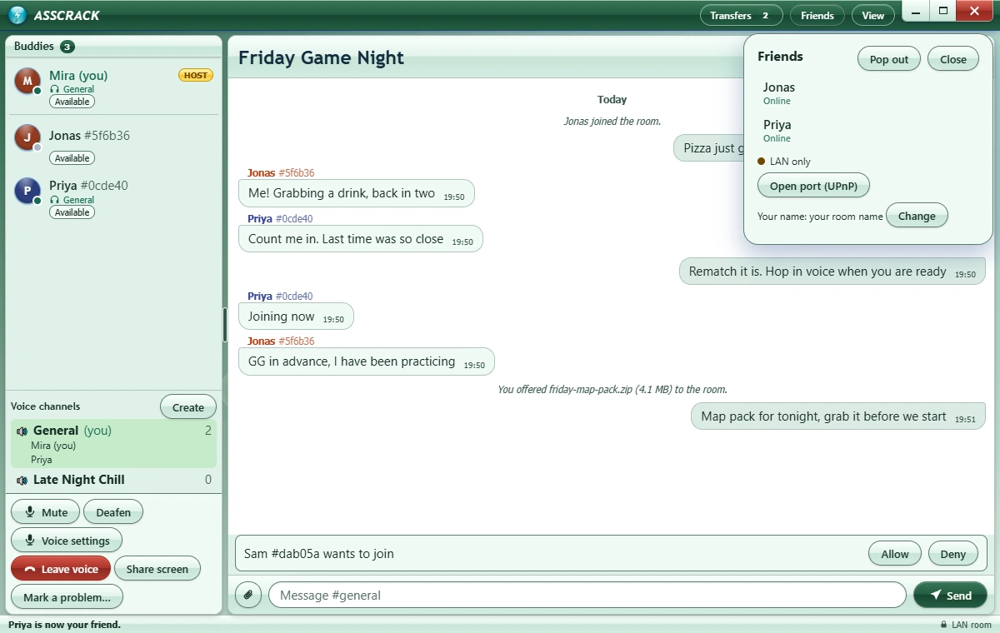
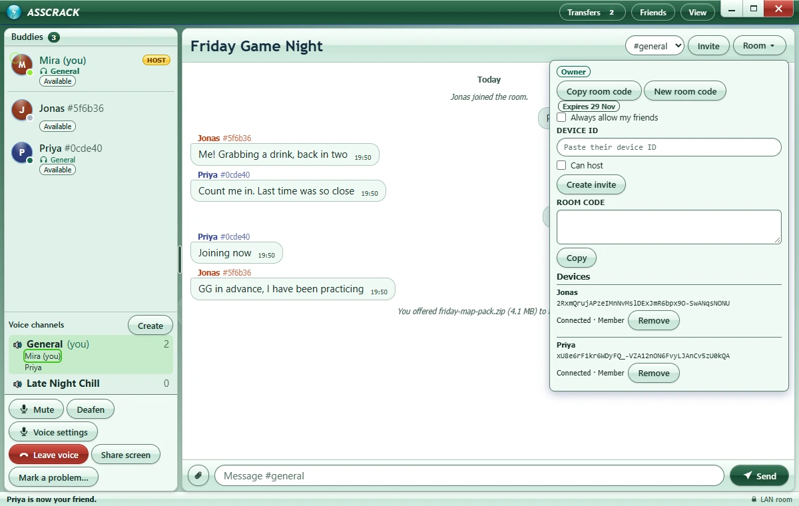

# ASSCRACK

**Voice, chat, files and screen share for you and your friends. No server, no sign-up. Just your PCs.**

<b>A</b>utomated <b>S</b>erver <b>S</b>witch in <b>C</b>ase <b>R</b>elays <b>A</b>re <b>C</b>rashed or <b>K</b>illed

 

 

&nbsp;

Pick <code>ASSCRACK-x.y.z-setup.exe</code> to install, or <code>ASSCRACK-x.y.z-portable.exe</code> to run it from any folder. 
Windows SmartScreen may warn you the first time: click <b>More info → Run anyway</b>. The app is not code-signed yet.

  

<picture>
  <source media="(prefers-color-scheme: dark)" srcset="docs/img/hero-dark.webp">
  
</picture>

## Take a look

<table>
  <tr>
    <td width="33%" align="center">
      <picture>
        <source media="(prefers-color-scheme: dark)" srcset="docs/img/login-dark.webp">
        
      </picture>
       <b>Start a room in seconds</b>
    </td>
    <td width="33%" align="center">
      <picture>
        <source media="(prefers-color-scheme: dark)" srcset="docs/img/friends-dark.webp">
        
      </picture>
       <b>Keep your friends close</b>
    </td>
    <td width="33%" align="center">
      <picture>
        <source media="(prefers-color-scheme: dark)" srcset="docs/img/invite-dark.webp">
        
      </picture>
       <b>You decide who gets in</b>
    </td>
  </tr>
</table>

Shown in the Aero Classic theme, or Aero Night if your GitHub is in dark mode. The app has six themes.

## What you get

<table>
  <tr>
    <td width="33%" valign="top"><b>Voice</b> Push-to-talk or voice activity, with noise suppression and echo cancellation.</td>
    <td width="33%" valign="top"><b>Voice channels</b> Split up for a match, then meet back in General.</td>
    <td width="33%" valign="top"><b>Chat with history</b> Channels, quotes, search, links and images. Saved rooms keep their history.</td>
  </tr>
  <tr>
    <td valign="top"><b>File sharing</b> Drop a file in. Big downloads pick up where they left off.</td>
    <td valign="top"><b>Screen share</b> Show your game or your desktop to the room.</td>
    <td valign="top"><b>Friends</b> A friends list, invites, and knock-to-join for rooms.</td>
  </tr>
  <tr>
    <td valign="top"><b>One portable folder</b> All your data sits in one folder next to the app.</td>
    <td valign="top"><b>Signed updates</b> New versions install from inside the app with one click.</td>
    <td valign="top"><b>Diagnostics on your terms</b> A report leaves your PC only when you click Send.</td>
  </tr>
</table>

## How it works

- **There is no server.** A room lives on your friends' PCs. If the host leaves, another trusted PC takes over and the room keeps going.
- **Every connection is encrypted** between the two PCs on each end.
- **The owner decides who gets in.** Share a room code or invite a friend, then click Allow when they knock.
- **On the same network**, friends find each other on their own. Over the internet, one of you needs an open port, and the app can ask your router for one.

## Get started

1. **Download** the installer or the portable app from the [latest release](https://github.com/noveblue53/asscrack/releases/latest).
2. **Open ASSCRACK**, pick a name and create a room.
3. **Bring your friends in.** Click **Invite → Copy room code**, send it to them, and click **Allow** when they knock.

## Privacy

No accounts, no ads, no company server in the middle. Your saved chat history stays on your PC, encrypted.
The room host passes voice along to everyone, so make someone you trust the host.
Diagnostics stay on your PC until you choose to send them.

## More

- [Changelog](CHANGELOG.md): what is new in each version
- [Status and roadmap](docs/STATUS.md): test results, known limits and what comes next
- [Development](docs/DEVELOPMENT.md): build from source with `npm run install:clean` (it works on a PC with no VC++ build tools), run the tests, and use the terminal demo
- [License](LICENSE): MIT

## Acknowledgments

- The libp2p team, for the peer-to-peer network stack
- Noveblue, Parker, Sunmanga, HBO Max Verstappen
- Discord ;)
